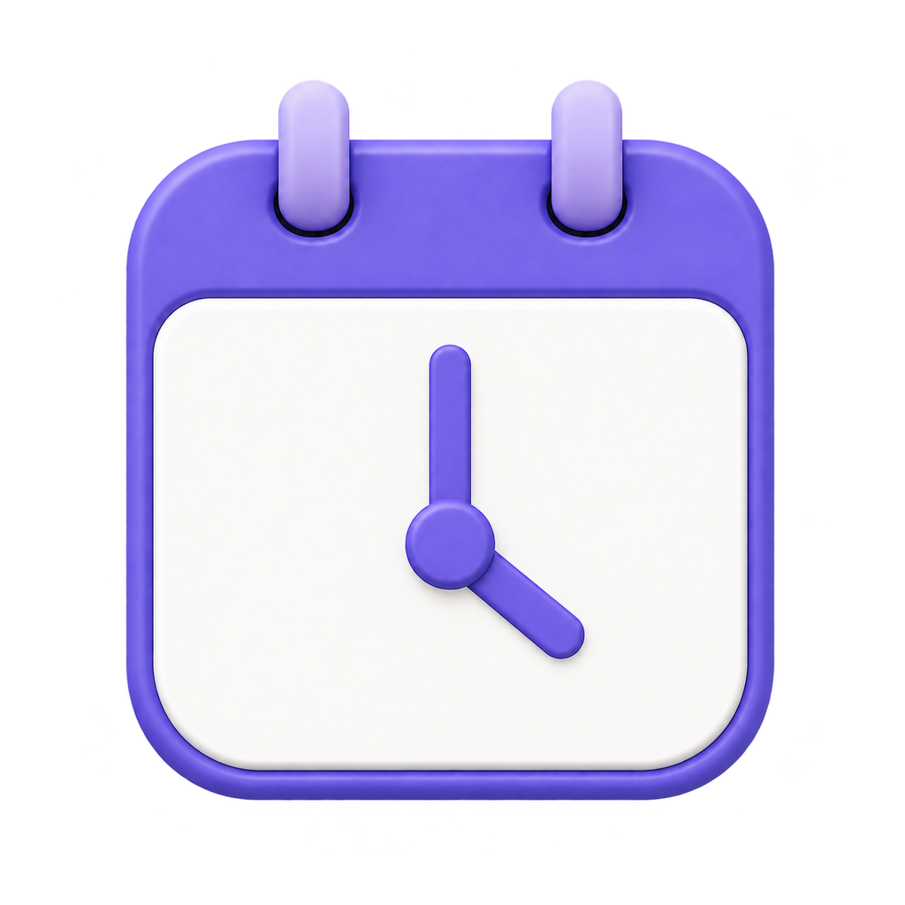
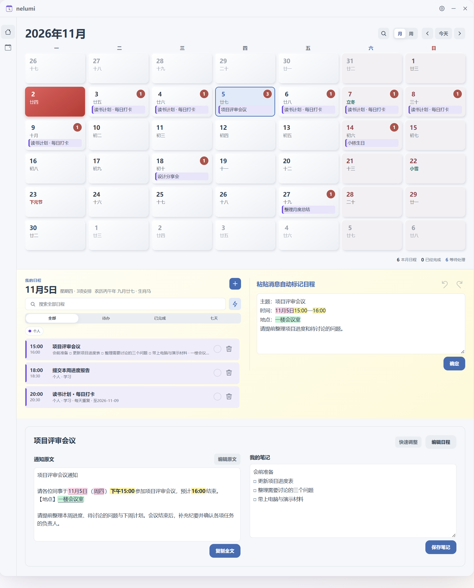
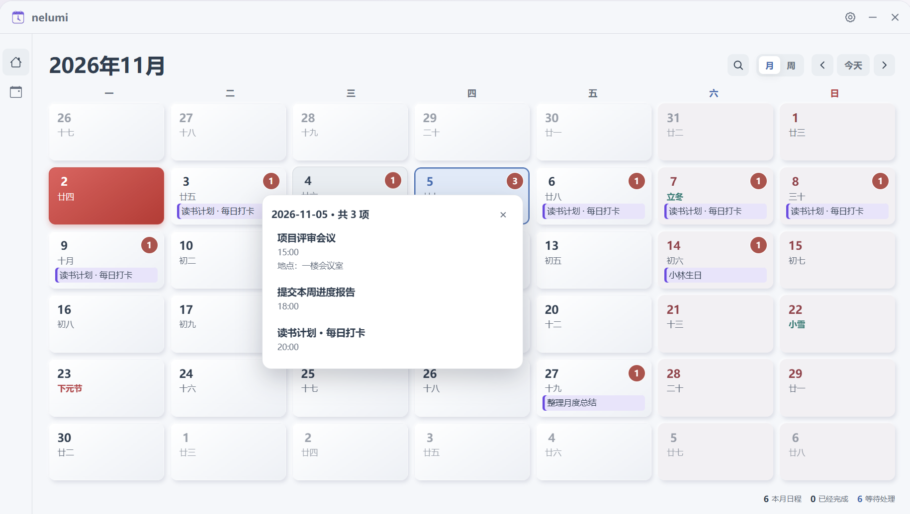
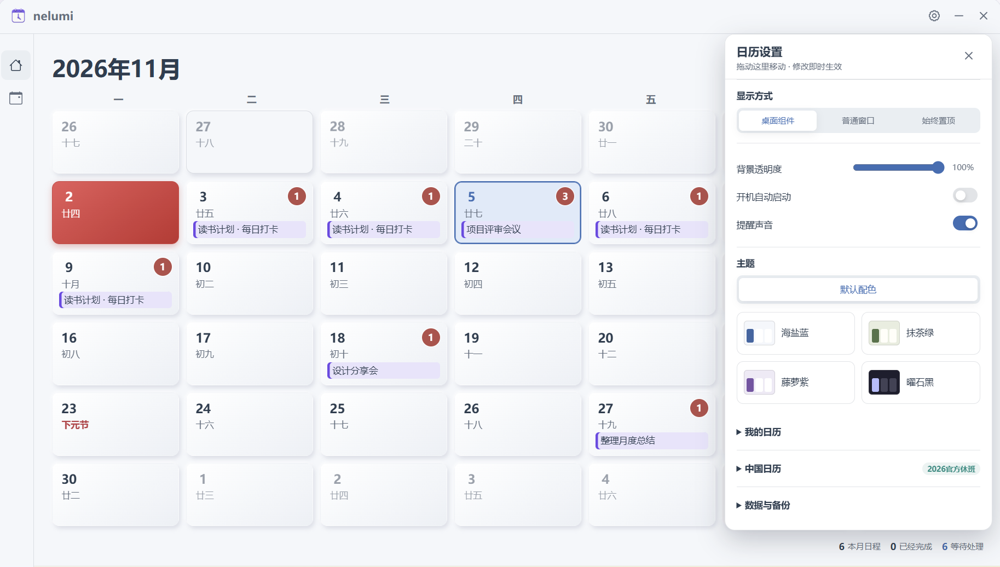

<p align="center">
  
</p>

<h1 align="center">nelumi</h1>

<p align="center"><strong>把群消息和通知图片，变成桌面上的日程。</strong></p>

<p align="center">中文通知提取 · 本地图片识别 · 农历生日提醒 · 电脑桌面日历</p>

<p align="center">
  <a href="https://github.com/blackkingdom03/nelumi/releases/latest"><strong>下载稳定版</strong></a>
  &nbsp;·&nbsp;
  <a href="https://blackkingdom03.github.io/nelumi/">网页预览</a>
  &nbsp;·&nbsp;
  <a href="#开始使用">使用指南</a>
  &nbsp;·&nbsp;
  <a href="https://github.com/blackkingdom03/nelumi/issues">反馈建议</a>
</p>

<p align="center">
  <a href="https://github.com/blackkingdom03/nelumi/releases/latest"></a>
  <a href="https://github.com/blackkingdom03/nelumi/actions/workflows/ci.yml"></a>
  <a href="LICENSE"></a>
</p>

讲座时间在群通知里，报名截止日期藏在长消息里，活动安排又是一张图片。nelumi 帮你把这些信息整理到桌面日历中，保留原文，并留出记录笔记的位置。

**粘贴消息 → 提取事项、日期和地点 → 在日历中查看与提醒。**

无需注册账号或配置 AI 密钥。文字提取与图片识别在本机完成。适合经常整理课程、讲座、会议、报名和个人纪念日的人。

## 先看看用起来是什么样

下面的截图和网页都用了虚构日程。点图片可以打开对应的网页预览，试着切换配色、点开事项。网页里的修改刷新后就会恢复；桌面提醒和图片识别请使用桌面版。

### 日程、通知和笔记，放在一起

上面看这个月的安排，下面看当天要做的事。粘贴通知后，日期、时间和地点会直接高亮。原文留着，旁边可以记下会前要准备的材料，回头不用再翻聊天记录。

[](https://blackkingdom03.github.io/nelumi/#overview)

[打开完整日历预览 →](https://blackkingdom03.github.io/nelumi/#overview)

### 一天有几件事，点数字就知道

圆圈里的数字是当天事项数。点开后能看到每件事的名称和时间，有地点就一起显示。日历格子放不下的内容，在这里看全。

[](https://blackkingdom03.github.io/nelumi/#day)

[打开当日事项预览 →](https://blackkingdom03.github.io/nelumi/#day)

### 配色和显示方式，按自己的习惯来

可以嵌在桌面上，也可以作为普通窗口或置顶显示。透明度随手调整，配色有默认、海盐蓝、抹茶绿、藤萝紫和曜石黑。设置面板可以拖动，调整时能直接看见效果。

[](https://blackkingdom03.github.io/nelumi/#settings)

[打开设置预览 →](https://blackkingdom03.github.io/nelumi/#settings)

## 从收到通知，到安排好下一件事

| 你收到的信息 | nelumi 帮你整理 |
| --- | --- |
| 一段会议或讲座通知 | 提取主题、日期、时间与地点，并在原文中高亮关键内容 |
| 一张活动海报或通知截图 | 在本机识别中英文文字，核对后生成日程 |
| “每年过生日，提前一周和一天提醒” | 预填生日、每年重复和提醒选项，打开编辑框供你确认 |
| 一段活动起止日期 | 普通活动标记开始和结束；每日打卡活动按天安排 |
| 同一天有好几件事 | 用数字圆圈显示事项数量，展开查看时间及已填写的地点 |
| 需要回头查找的安排 | 按关键词搜索，并把通知原文和自己的笔记一起留在事项中 |

## 试试这三条消息

以下均为虚构示例，已用当前版本的解析器核对。没有写年份的日期按输入当年识别。

### 一场会议，时间和地点一起填好

```text
主题：项目评审会议
时间：11月5日15:00
地点：一楼会议室
```

得到 **11 月 5 日 15:00 · 项目评审会议**，地点填入“一楼会议室”。保存后，原文仍然保留在事项详情中。

### 一次设置，记住每年的生日

```text
小林的生日是阳历12月8日，每年提醒，提前1周和1天提醒。
地点：家里
```

编辑框会预填 **12 月 8 日、每年重复、提前 7 天与 1 天提醒**，你检查后再保存。农历生日也可以设置；遇到无对应闰月或日期的年份，会保留提示供确认，不擅自换到另一天。

### 连续打卡，在活动期内每天出现

```text
活动名称：读书打卡
活动时间：11月3日至11月9日
每天晚上20:00打卡
```

预填 **11 月 3—9 日每天 20:00** 的打卡事项，确认后加入日历。普通起止活动仍按开始和结束两天标记。

> 普通通知可直接添加；生日、重复或带提醒的消息会先打开编辑框。提取和图片识别可能出错，重要安排请核对后再使用，也可以随时编辑或撤销。

## 放在桌面上，也照顾你的使用习惯

- **熟悉的中国日历**：查看农历、节气、节日，以及已核验年份的放假与补班。[查看资料范围](#日历资料的范围)
- **按自己的节奏浏览**：月、周与年份视图，搜索日程，查看当天全部事项。
- **通知与笔记放在一起**：编辑原文、复制全文、打开其中的网址，再补上要带的材料和待办细节。
- **选择合适的显示方式**：桌面组件、普通窗口或置顶显示，可调整背景透明度。
- **五种配色随时切换**：默认配色、海盐蓝、抹茶绿、藤萝紫、曜石黑。
- **操作可以回退**：支持完成标记、删除、撤销与重做。

## 选择你的电脑版本

原 Windows 稳定版继续保留；新增的多平台版本先作为测试版提供。

**[多平台测试版 v0.6.0-beta.1 →](https://github.com/blackkingdom03/nelumi/releases/tag/v0.6.0-beta.1)** · [Windows 稳定版 →](https://github.com/blackkingdom03/nelumi/releases/latest)

| 电脑 | 对应文件（省略版本号前缀） |
| --- | --- |
| Windows · Intel / AMD | `windows-x64-setup.exe` 安装版 / `windows-x64.zip` 便携版 |
| Windows · ARM / 骁龙 | `windows-arm64-setup.exe` / `windows-arm64.zip` |
| Mac · M 系列芯片 | `macos-arm64.dmg` |
| Mac · Intel | `macos-x64.dmg` |
| Linux · Intel / AMD | `linux-x86_64.AppImage` / `linux-amd64.deb` |

测试版需要通过五类测试机的自动检查后才发布；尚未覆盖所有真实设备上的通知、开机启动和桌面显示。安装包未签名，Mac 版未经过 Apple 公证。[查看适配范围与验证方式](docs/desktop-platforms.md)。

## 开始使用

**[下载最新版 Windows 便携包 →](https://github.com/blackkingdom03/nelumi/releases/latest)**

支持 **Windows 10 / 11 · x64**。无需安装向导，完整解压即可运行。

1. 在下载页选择 `nelumi-版本号-windows-x64.zip`。仅使用软件时，不需要下载 `Source code`。
2. 解压整个文件夹到有写入权限的位置，双击 `nelumi.exe`；请勿在压缩包内运行，也不要只移动 EXE。
3. 在消息框粘贴文字或图片。按 **Enter** 或点击“确定”处理消息；**Shift + Enter** 换行。图片识别完成后先核对文字，再确定添加。
4. 点击事项查看原文与笔记，点击日期上的数量圆圈查看当天全部安排。

当前程序尚未进行代码签名；下载页提供 SHA-256 校验文件。更新已有版本前，请先备份自己的数据，具体位置见下文。

## 常见问题

**需要账号、联网或付费 AI 服务吗？**

日程管理不需要注册账号，文字提取和图片识别使用本地规则与随包提供的模型，不需要 AI 密钥。获取日历资料、下载更新或打开外部网址时，需要访问相应网络服务。

**消息没有年份，或者没有具体时间，会怎样处理？**

未注明年份时使用当年；完全没有日期时放到今天，未写具体几点时按全天事项处理。缺失信息仍建议你手动补全。

**退出程序后还能提醒吗？**

提醒需要程序保持运行。电脑关机或程序退出期间，不能保证发出提醒；全天事项的提醒时刻可在编辑框中设置。

**未来年份的调休也确定了吗？**

可以浏览未来年份，但未来调休只有在官方公布并完成核验后才作为正式安排。当前随附正式核验资料为 2026 年。

## 数据与隐私

Windows 日程及设置仍保存在程序旁的 `data/` 文件夹，主要数据文件是 `data/deskcal-data.json`。Mac 使用 `~/Library/Application Support/nelumi/`，Linux 使用 `$XDG_CONFIG_HOME/nelumi/`（通常是 `~/.config/nelumi/`）。开发模式使用 `.profile/`。多台设备暂不自动同步，可以通过导出、导入备份转移日程。通知提取与图片 OCR 在本地执行，不需要配置云端 AI 服务；OCR 模型随程序提供。

更新前退出程序并备份整个 `data/` 文件夹，然后替换程序文件，保留自己的数据。新版本发布包不包含个人日程、笔记或测试账户。

点击外部网址、获取日历资料等操作会访问对应网络服务。提交 Issue 时请使用虚构例子，不要上传自己的数据文件、私人通知或包含个人信息的截图。

## 日历资料的范围

<details>
<summary>查看权威来源、核验记录与适用范围</summary>

农历与节气使用 `lunar-javascript`，并结合香港天文台的 1901—2100 年历表核对与修正。核验快照和差异记录在 [`audit/calendar-2026-10-22`](audit/calendar-2026-10-22)，来源与适用条款见 [第三方声明](THIRD_PARTY_NOTICES.md)。1901 年初的部分字段核验覆盖有限，报告保留了这一范围。

**放假与补班以国务院办公厅对应年份的公告为准。** 当前随附正式核验资料为 2026 年；能浏览未来年份不等于未来调休安排已经公布。天文台也提示部分远期新月、节气日期可能存在一天差异，因此本项目不承诺所有年份绝对无误。

</details>

## 本地开发

需要 Git、Node.js 22 或更新版本，以及 Windows、macOS 或 Linux 桌面环境。

```bash
git clone https://github.com/blackkingdom03/nelumi.git
cd nelumi
npm ci
npm run check
npm test
npm start
```

构建 Windows 便携版目录：

```bash
npm run dist:portable
```

产物在 `release/win-unpacked/`，发布时应打包整个目录，并确认其中不含运行后生成的 `data/`。Electron 窗口测试可通过 `npm run test:settings`、`npm run test:notebook`、`npm run test:ocr` 等命令运行；这些测试会创建临时测试配置目录。

其他平台使用 `npm run dist:mac`、`npm run dist:linux`，Windows ARM 使用 `npm run dist:win:arm64`。请在对应系统构建；发布前运行打包产物检查，具体见 [适配说明](docs/desktop-platforms.md)。

## 许可证与致谢

nelumi 基于 [DeskCal](https://github.com/kangkangStudent/DeskCal) 定制，界面参考 [neisme Calendar](https://github.com/dikafryo/neisme-Calendar)。这是独立维护的衍生项目，不是上述项目的官方版本。

应用代码使用 [MIT 许可证](LICENSE)，保留 DeskCal 的原有版权声明。感谢 DeskCal、neisme Calendar、Bootstrap Icons、lunar-javascript、Tesseract.js 及相关数据来源。

OCR 引擎、模型、Electron 和历表数据各有相应许可证或使用条款；本仓库的 MIT 许可证不替代它们。完整出处、版本与复用范围请阅读 [THIRD_PARTY_NOTICES.md](THIRD_PARTY_NOTICES.md)。

## 一起让通知更好整理

我会不定期更新这个项目，修复问题，也慢慢补上用得着的功能。新版本和改动会写在[发布记录](https://github.com/blackkingdom03/nelumi/releases)里。

如果某段通知没有正确识别，欢迎提交[问题反馈](https://github.com/blackkingdom03/nelumi/issues/new?template=bug_report.yml)，附上去除个人信息后的示例。希望增加功能，可以提交[功能建议](https://github.com/blackkingdom03/nelumi/issues/new?template=feature_request.yml)。

喜欢这个项目，可以点一个 **Star**，或把[下载页](https://github.com/blackkingdom03/nelumi/releases/latest)分享给同样需要整理通知的人。参与开发请阅读 [贡献指南](CONTRIBUTING.md)。

---

**English overview:** nelumi is a local-first desktop calendar for turning Chinese notices and images into scheduled tasks. It includes on-device OCR, lunar and solar birthday recurrence, reminders, source-text notes, and five themes. The current interface is in Chinese. [Windows stable release](https://github.com/blackkingdom03/nelumi/releases/latest) · [Windows / macOS / Linux beta](https://github.com/blackkingdom03/nelumi/releases/tag/v0.6.0-beta.1).
